# iOS Production — Từ Code đến App Store

> Hướng dẫn toàn diện về quy trình phát hành ứng dụng iOS lên App Store: Code Signing, Build & Archive, TestFlight, App Store Review, Privacy, Security, CI/CD và vận hành sau release.
> 
> Tài liệu được viết theo chuẩn thực tế, tập trung vào những gì cần làm để đưa app từ môi trường phát triển lên production một cách an toàn và chuyên nghiệp.

**Môi trường tham khảo:** iOS 17.0+, Xcode 16+, Swift 6

---

## Mục lục

- [1. Tổng quan quy trình phát hành](#1-tổng-quan-quy-trình-phát-hành)
- [2. Apple Developer Program](#2-apple-developer-program)
- [3. Code Signing & Provisioning](#3-code-signing--provisioning)
- [4. App ID, Capabilities & Entitlements](#4-app-id-capabilities--entitlements)
- [5. Build Configuration & Versioning](#5-build-configuration--versioning)
- [6. Info.plist và Cấu hình App](#6-infoplist-và-cấu-hình-app)
- [7. Privacy Manifest (PrivacyInfo.xcprivacy)](#7-privacy-manifest-privacyinfoxcprivacy)
- [8. Archive, Export & Upload](#8-archive-export--upload)
- [9. TestFlight](#9-testflight)
- [10. App Store Connect](#10-app-store-connect)
- [11. App Store Review Guidelines](#11-app-store-review-guidelines)
- [12. App Store Submission](#12-app-store-submission)
- [13. Bảo mật Production](#13-bảo-mật-production)
- [14. CI/CD với GitHub Actions](#14-cicd-với-github-actions)
- [15. Crash Reporting & Monitoring](#15-crash-reporting--monitoring)
- [16. Phased Release, Rollback & Incident Response](#16-phased-release-rollback--incident-response)
- [17. App Store Optimization (ASO)](#17-app-store-optimization-aso)
- [18. Checklist Production hoàn chỉnh](#18-checklist-production-hoàn-chỉnh)
- [19. Troubleshooting thường gặp](#19-troubleshooting-thường-gặp)
- [20. Tài liệu tham khảo](#20-tài-liệu-tham-khảo)

---

## 1. Tổng quan quy trình phát hành

Quy trình phát hành iOS chuẩn bao gồm các bước sau:

```mermaid
graph LR
    A[Phát triển & Test] --> B[Code Signing Setup]
    B --> C[Build Configuration]
    C --> D[Archive Release Build]
    D --> E[Export & Upload]
    E --> F[TestFlight Beta Testing]
    F --> G[App Store Connect Setup]
    G --> H[Submit for Review]
    H --> I[App Review]
    I --> J[Release to App Store]
```



| Giai đoạn | Mục tiêu | Thời gian ước tính |
|---|---|---|
| **Development** | Hoàn thiện tính năng, unit test, UI test | Tùy dự án |
| **Beta Testing** | Test trên thiết bị thật, fix bugs | 1-7 ngày |
| **Submission** | Chuẩn bị metadata, screenshot, review notes | 1-2 giờ |
| **Review** | Apple review app | Thường 24-48 giờ (có thể nhanh/chậm hơn) |
| **Release** | Phát hành lên App Store | Tức thời hoặc theo lịch |

---

## 2. Apple Developer Program

Để phát hành lên App Store, cần tham gia **Apple Developer Program**.

| Loại tài khoản | Chi phí | Quyền lợi |
|---|---|---|
| **Apple Developer Program (Individual)** | $99/năm | Phát hành App Store, TestFlight, Capabilities |
| **Apple Developer Program (Organization)** | $99/năm | Giống Individual nhưng có thể thêm team members, dùng company name |
| **Apple Developer Enterprise Program** | $299/năm | Phát hành in-house, KHÔNG lên App Store |

**Đăng ký tại:** [developer.apple.com/programs](https://developer.apple.com/programs/)

**Lưu ý:**
- Cần Apple ID với xác thực 2 yếu tố (2FA)
- Thông tin thanh toán hợp lệ
- Với Organization cần D-U-N-S number

---

## 3. Code Signing & Provisioning

Code Signing đảm bảo app được xác thực từ nguồn đáng tin cậy và chưa bị chỉnh sửa.

### 3.1 Khái niệm cốt lõi

| Thành phần | Mô tả |
|---|---|
| **Signing Certificate** | Chứng chỉ số xác thực danh tính developer/team. Gồm private key (trên máy) và public key (trên Apple) |
| **App ID** | Định danh duy nhất cho app (Bundle Identifier) |
| **Provisioning Profile** | File kết nối Certificate + App ID + Devices (nếu Ad Hoc/Development). Quy định app có thể chạy ở đâu |
| **Entitlements** | Quyền đặc biệt app được phép sử dụng (Push, Keychain, App Groups,...) |

### 3.2 Loại Certificate

| Certificate | Mục đích | Sử dụng |
|---|---|---|
| **Apple Development** | Phát triển trên thiết bị thật | Debug/Development build |
| **Apple Distribution** | Phát hành App Store, Ad Hoc | Release build cho TestFlight/App Store |

### 3.3 Loại Provisioning Profile

| Profile | Mục đích | Giới hạn |
|---|---|---|
| **Development** | Chạy trên thiết bị đăng ký trong profile | Chỉ thiết bị trong danh sách UDID |
| **Ad Hoc** | Phân phối giới hạn không qua App Store | Tối đa 100 thiết bị/năm |
| **App Store** | Phát hành chính thức lên App Store | Không giới hạn thiết bị |

### 3.4 Quản lý với Xcode

**Tự động (khuyến nghị cho người mới):**
1. Mở Xcode → Target → Signing & Capabilities
2. Chọn Team
3. Bật "Automatically manage signing"
4. Xcode tự động tạo và quản lý certificate/profile

**Thủ công (khuyến nghị cho team/CI):**
1. Tạo certificate trên [developer.apple.com](https://developer.apple.com/account/resources/certificates)
2. Tạo App ID
3. Tạo Provisioning Profile tương ứng
4. Tải về và cài đặt, hoặc dùng trong CI

### 3.5 Kiểm tra certificate

```bash
# Liệt kê certificate đang có
security find-identity -v -p codesigning

# Export certificate (.p12) - CHỈ dùng cho CI/team, bảo mật
# Keychain Access > Certificate > Export as .p12 (có password)
```

**Lưu ý bảo mật:**
- **KHÔNG BAO GIỜ** commit `.p12`, `.mobileprovision`, private key vào Git
- Chỉ lưu trong Keychain local hoặc Secret Manager (GitHub Secrets)
- Mất private key = phải tạo certificate mới

---

## 4. App ID, Capabilities & Entitlements

### 4.1 Tạo App ID

1. Truy cập [Certificates, Identifiers & Profiles](https://developer.apple.com/account/resources/identifiers)
2. Chọn `Identifiers` → `+`
3. Chọn `App IDs` → `App`
4. Điền Description và **Bundle ID** (explicit, không wildcard)
   - Format: `com.companyname.appname`
5. Chọn Capabilities cần thiết

### 4.2 Capabilities phổ biến

| Capability | Khi dùng | Ghi chú |
|---|---|---|
| **Push Notifications** | Gửi thông báo | Cần cấu hình APNs |
| **Sign in with Apple** | Đăng nhập bằng Apple | Ngày càng phổ biến, nhiều app yêu cầu |
| **Associated Domains** | Universal Links | Cho deep linking |
| **App Groups** | Chia sẻ data với Extension/Widget | Cần suite name unique |
| **Keychain Sharing** | Chia sẻ Keychain giữa apps/extensions | Ít dùng |
| **Background Modes** | Background fetch, remote notification, location | Chỉ bật khi thật sự cần |
| **HealthKit** | Sức khỏe | Cần review kỹ |
| **HomeKit** | Nhà thông minh | Chỉ dùng nếu thực sự cần |

### 4.3 Entitlements file

File `.entitlements` tự động được tạo khi bật capability. Kiểm tra trong Target → Signing & Capabilities.

```xml
<?xml version="1.0" encoding="UTF-8"?>
<!DOCTYPE plist PUBLIC "-//Apple//DTD PLIST 1.0//EN" "http://www.apple.com/DTDs/PropertyList-1.0.dtd">
<plist version="1.0">
<dict>
    <key>aps-environment</key>
    <string>production</string>
    <key>com.apple.developer.associated-domains</key>
    <array>
        <string>applinks:example.com</string>
    </array>
</dict>
</plist>
```

**Quan trọng:** `aps-environment` phải là `production` cho App Store build, `development` cho dev build.

---

## 5. Build Configuration & Versioning

### 5.1 Build Configurations

Xcode có sẵn `Debug` và `Release`. Nên thêm `Staging` nếu muốn test với backend staging trước khi release.

| Configuration | Mục đích | Đặc điểm |
|---|---|---|
| **Debug** | Phát triển hàng ngày | `SWIFT_OPTIMIZATION_LEVEL = -Onone`, có debug symbols, log nhiều |
| **Staging** | QA/Beta testing nội bộ | Gần giống Release nhưng dùng staging API |
| **Release** | Production/App Store | `SWIFT_OPTIMIZATION_LEVEL = -O`, tối ưu, strip debug info |

### 5.2 Versioning

Có 2 trường quan trọng trong `Info.plist`:

| Key | Tên hiển thị | Ví dụ | Quy tắc |
|---|---|---|---|
| `CFBundleShortVersionString` | **Marketing Version** | `1.2.0` | Theo [Semantic Versioning](https://semver.org/): MAJOR.MINOR.PATCH |
| `CFBundleVersion` | **Build Number** | `123` hoặc `1.2.0.123` | Tăng **mỗi lần** upload build lên App Store Connect. Phải tăng đơn điệu |

**Quy tắc tăng version:**
- **PATCH** (1.2.0 → 1.2.1): Bug fix nhỏ
- **MINOR** (1.2.0 → 1.3.0): Thêm tính năng mới, backward compatible
- **MAJOR** (1.2.0 → 2.0.0): Thay đổi lớn, có thể breaking change

### 5.3 Sử dụng .xcconfig

Tách cấu hình theo environment giúp tránh nhầm lẫn.

```text
// Config/Debug.xcconfig
API_BASE_URL = https://api-dev.example.com
APP_DISPLAY_NAME = MyApp Dev
PRODUCT_BUNDLE_IDENTIFIER = com.example.myapp.dev

// Config/Release.xcconfig
API_BASE_URL = https://api.example.com
APP_DISPLAY_NAME = MyApp
PRODUCT_BUNDLE_IDENTIFIER = com.example.myapp
```

Truy cập trong code:

```swift
enum AppConfig {
    static var apiBaseURL: URL {
        guard let urlString = Bundle.main.object(forInfoDictionaryKey: "APIBaseURL") as? String,
              let url = URL(string: urlString) else {
            fatalError("APIBaseURL not found")
        }
        return url
    }
}
```

Thêm key `APIBaseURL` vào `Info.plist`:
```xml
<key>APIBaseURL</key>
<string>$(API_BASE_URL)</string>
```

### 5.4 Auto-increment Build Number trong CI

```bash
# Sử dụng git commit count
BUILD_NUMBER=$(git rev-list --count HEAD)
xcrun agvtool new-version -all $BUILD_NUMBER

# Hoặc dùng GitHub run number
xcrun agvtool new-version -all ${{ github.run_number }}
```

---

## 6. Info.plist và Cấu hình App

### 6.1 Các key quan trọng

| Key | Bắt buộc | Mô tả |
|---|---|---|
| `CFBundleDisplayName` | Có | Tên hiển thị trên home screen |
| `CFBundleIdentifier` | Có | Bundle ID |
| `CFBundleShortVersionString` | Có | Marketing version |
| `CFBundleVersion` | Có | Build number |
| `UILaunchStoryboardName` | Có | Launch Screen |
| `UISupportedInterfaceOrientations` | Có | Hướng màn hình hỗ trợ |
| `LSApplicationCategoryType` | Khuyến nghị | Danh mục app |

### 6.2 Permission Usage Descriptions

**Luôn** giải thích rõ ràng tại sao cần quyền. Text mơ hồ sẽ bị từ chối.

| Permission | Key | Ví dụ mô tả tốt |
|---|---|---|
| **Camera** | `NSCameraUsageDescription` | "Ứng dụng cần truy cập camera để chụp ảnh đại diện" |
| **Photo Library** | `NSPhotoLibraryUsageDescription` | "Ứng dụng cần truy cập thư viện ảnh để chọn ảnh" |
| **Location When In Use** | `NSLocationWhenInUseUsageDescription` | "Ứng dụng cần vị trí để tìm cửa hàng gần bạn" |
| **Microphone** | `NSMicrophoneUsageDescription` | "Ứng dụng cần micro để ghi âm" |
| **Notifications** | Không cần key riêng | Xin qua `UNUserNotificationCenter` |
| **Face ID** | `NSFaceIDUsageDescription` | "Sử dụng Face ID để xác thực đăng nhập" |

### 6.3 App Transport Security (ATS)

Mặc định iOS yêu cầu HTTPS. Chỉ cho phép HTTP trong trường hợp đặc biệt.

```xml
<key>NSAppTransportSecurity</key>
<dict>
    <key>NSAllowsArbitraryLoads</key>
    <false/>
    <!-- CHỈ dùng cho development với localhost -->
    <key>NSAllowsLocalNetworking</key>
    <true/>
</dict>
```

**Quy tắc:** **KHÔNG BAO GIỜ** set `NSAllowsArbitraryLoads` = `true` trong Release build.

### 6.4 URL Schemes

```xml
<key>CFBundleURLTypes</key>
<array>
    <dict>
        <key>CFBundleURLSchemes</key>
        <array>
            <string>myapp</string>
        </array>
        <key>CFBundleURLName</key>
        <string>com.example.myapp</string>
    </dict>
</array>
```

---

## 7. Privacy Manifest (PrivacyInfo.xcprivacy)

Từ iOS 17 trở đi, Apple yêu cầu **Privacy Manifest** cho app và tất cả third-party SDK. Đây là yêu cầu bắt buộc cho hầu hết submission.

### 7.1 Tạo Privacy Manifest

1. File → New → File → App Privacy File
2. Đặt tên `PrivacyInfo.xcprivacy`
3. Thêm vào app target

### 7.2 Cấu trúc cơ bản

```xml
<?xml version="1.0" encoding="UTF-8"?>
<!DOCTYPE plist PUBLIC "-//Apple//DTD PLIST 1.0//EN" "http://www.apple.com/DTDs/PropertyList-1.0.dtd">
<plist version="1.0">
<dict>
    <!-- Có theo dõi người dùng không? -->
    <key>NSPrivacyTracking</key>
    <false/>
    
    <!-- Các domain tracking -->
    <key>NSPrivacyTrackingDomains</key>
    <array/>
    
    <!-- Loại dữ liệu thu thập -->
    <key>NSPrivacyCollectedDataTypes</key>
    <array>
        <dict>
            <key>NSPrivacyCollectedDataType</key>
            <string>NSPrivacyCollectedDataTypeEmailAddress</string>
            <key>NSPrivacyCollectedDataTypeLinked</key>
            <true/>
            <key>NSPrivacyCollectedDataTypeTracking</key>
            <false/>
            <key>NSPrivacyCollectedDataTypePurposes</key>
            <array>
                <string>NSPrivacyCollectedDataTypePurposeAppFunctionality</string>
            </array>
        </dict>
    </array>
    
    <!-- Required Reason APIs -->
    <key>NSPrivacyAccessedAPITypes</key>
    <array>
        <dict>
            <key>NSPrivacyAccessedAPIType</key>
            <string>NSPrivacyAccessedAPICategoryUserDefaults</string>
            <key>NSPrivacyAccessedAPITypeReasons</key>
            <array>
                <string>CA92.1</string>
            </array>
        </dict>
        <dict>
            <key>NSPrivacyAccessedAPIType</key>
            <string>NSPrivacyAccessedAPICategoryFileTimestamp</string>
            <key>NSPrivacyAccessedAPITypeReasons</key>
            <array>
                <string>C617.1</string>
            </array>
        </dict>
    </array>
</dict>
</plist>
```

### 7.3 Collected Data Types phổ biến

| Data Type | Khi dùng |
|---|---|
| `NSPrivacyCollectedDataTypeEmailAddress` | Email đăng nhập/đăng ký |
| `NSPrivacyCollectedDataTypeName` | Tên người dùng |
| `NSPrivacyCollectedDataTypePhoneNumber` | Số điện thoại |
| `NSPrivacyCollectedDataTypePhysicalAddress` | Địa chỉ |
| `NSPrivacyCollectedDataTypePhotosOrVideos` | Ảnh/video upload |
| `NSPrivacyCollectedDataTypeUserID` | User ID nội bộ |
| `NSPrivacyCollectedDataTypeDeviceID` | Device ID (hiếm khi dùng) |

### 7.4 Purposes

| Purpose | Ý nghĩa |
|---|---|
| `NSPrivacyCollectedDataTypePurposeAppFunctionality` | Cần thiết để app hoạt động |
| `NSPrivacyCollectedDataTypePurposeAnalytics` | Phân tích sử dụng |
| `NSPrivacyCollectedDataTypePurposeProductPersonalization` | Cá nhân hóa trải nghiệm |
| `NSPrivacyCollectedDataTypePurposeAdvertising` | Quảng cáo |
| `NSPrivacyCollectedDataTypePurposeDeveloperAdvertising` | Quảng cáo của developer |

### 7.5 Required Reason API Categories

| API Category | Reason Codes phổ biến | Ghi chú |
|---|---|---|
| `NSPrivacyAccessedAPICategoryUserDefaults` | `CA92.1` | Đọc/ghi UserDefaults của app |
| `NSPrivacyAccessedAPICategoryFileTimestamp` | `C617.1` | Truy cập file timestamp |
| `NSPrivacyAccessedAPICategoryDiskSpace` | `E174.1`, `85F4.1` | Kiểm tra dung lượng |
| `NSPrivacyAccessedAPICategorySystemBootTime` | `35F9.1` | Tính toán thời gian |

**Quan trọng:** Chỉ khai báo những gì app **thực sự** sử dụng. Kiểm tra bằng static analysis hoặc code review.

### 7.6 Kiểm tra Privacy Manifest

```bash
# Kiểm tra file hợp lệ
plutil -lint PrivacyInfo.xcprivacy

# Xem trong built app
find DerivedData -name "PrivacyInfo.xcprivacy"
```

---

## 8. Archive, Export & Upload

### 8.1 Chuẩn bị trước khi Archive

- [ ] Chọn scheme đúng (Release)
- [ ] Build Configuration = `Release`
- [ ] Chọn "Any iOS Device (arm64)" hoặc generic device
- [ ] Đảm bảo không có warning quan trọng
- [ ] Test build chạy được
- [ ] Version và Build Number đã cập nhật

### 8.2 Archive từ Xcode

1. `Product` → `Archive`
2. Đợi Xcode build xong (có thể mất vài phút)
3. Organizer sẽ tự động mở khi hoàn thành

### 8.3 Archive từ Command Line (cho CI)

```bash
# Clean và Archive
xcodebuild clean archive \
  -workspace MyApp.xcworkspace \
  -scheme MyApp \
  -configuration Release \
  -destination 'generic/platform=iOS' \
  -archivePath ./build/MyApp.xcarchive \
  -allowProvisioningUpdates \
  CODE_SIGN_STYLE=Automatic

# Kiểm tra archive
ls -la ./build/MyApp.xcarchive/
```

### 8.4 Export Options

Tạo file `ExportOptions.plist`:

```xml
<?xml version="1.0" encoding="UTF-8"?>
<!DOCTYPE plist PUBLIC "-//Apple//DTD PLIST 1.0//EN" "http://www.apple.com/DTDs/PropertyList-1.0.dtd">
<plist version="1.0">
<dict>
    <key>method</key>
    <string>app-store-connect</string>
    <key>teamID</key>
    <string>YOUR_TEAM_ID</string>
    <key>uploadSymbols</key>
    <true/>
    <key>uploadBitcode</key>
    <false/>
    <key>signingStyle</key>
    <string>automatic</string>
    <key>destination</key>
    <string>upload</string>
</dict>
</plist>
```

**Giá trị `method`:**
- `app-store-connect` - Upload lên App Store Connect (TestFlight/App Store)
- `ad-hoc` - Export IPA cho Ad Hoc distribution
- `enterprise` - Enterprise distribution
- `development` - Development build

### 8.5 Export IPA

```bash
xcodebuild -exportArchive \
  -archivePath ./build/MyApp.xcarchive \
  -exportOptionsPlist ./ExportOptions.plist \
  -exportPath ./build/export \
  -allowProvisioningUpdates
```

Sau khi export thành công, sẽ có file `MyApp.ipa` trong thư mục export.

### 8.6 Upload lên App Store Connect

**Cách 1: Xcode Organizer (thủ công)**
1. Mở Organizer → Archives → Chọn archive → Distribute App
2. Chọn `App Store Connect` → `Upload`
3. Chọn signing options → Upload

**Cách 2: xcrun altool (CI)**

Cần App Store Connect API Key trước:

1. Truy cập [App Store Connect → Users and Access → Keys](https://appstoreconnect.apple.com/access/integrations/api)
2. Tạo API Key với role `App Manager` hoặc `Admin`
3. Tải file `.p8` (chỉ tải 1 lần)
4. Lưu `Key ID`, `Issuer ID`, nội dung file `.p8`

```bash
# Upload IPA
xcrun altool --upload-app \
  --type ios \
  --file ./build/export/MyApp.ipa \
  --apiKey YOUR_KEY_ID \
  --apiIssuer YOUR_ISSUER_ID \
  --verbose
```

**Cách 3: Transporter app (macOS)**
- Tải [Transporter](https://apps.apple.com/us/app/transporter/id1450874784) từ Mac App Store
- Kéo thả IPA vào Transporter để upload

### 8.7 Xử lý sau upload

Sau khi upload thành công:
1. Build sẽ xuất hiện trong App Store Connect sau vài phút (thường 5-30 phút)
2. Cần **chờ xử lý** (processing) trước khi có thể dùng cho TestFlight hoặc submit review
3. Nếu có lỗi, App Store Connect sẽ gửi email thông báo

---

## 9. TestFlight

TestFlight cho phép test beta với internal và external testers trước khi lên App Store.

### 9.1 Phân loại tester

| Nhóm | Số lượng | Yêu cầu Review | Mục đích |
|---|---|---|---|
| **Internal Testers** | Tối đa 100 | Không cần beta review | Thành viên trong App Store Connect team (Admin, App Manager, Developer, Marketing) |
| **External Testers** | Tối đa 10,000 | Cần **Beta App Review** cho build đầu tiên của group/version mới | Người bên ngoài team |

### 9.2 Thêm testers

**Internal:**
1. App Store Connect → TestFlight → Internal Testing → + Add Testers
2. Chọn thành viên từ team

**External:**
1. Tạo group: `TestFlight` → `External Testing` → Create Group
2. Thêm build vào group
3. Thêm testers (email) hoặc chia sẻ public link (nếu bật)

### 9.3 Beta App Review

Với external testers, build cần pass **Beta App Review** trước khi testers có thể cài đặt.

**Thông tin cần chuẩn bị:**
- **What to Test**: Hướng dẫn ngắn gọn cho tester (tính năng cần test, flow quan trọng)
- **Contact Information**: Email, số điện thoại
- **Demo Account** (nếu cần đăng nhập): Username + Password
- **Notes**: Thông tin bổ sung nếu có

**Thời gian review:** Thường 15-60 phút, nhanh hơn App Store review.

### 9.4 TestFlight Best Practices

- **Mô tả rõ ràng**: Viết "What to Test" bằng tiếng Việt hoặc tiếng Anh rõ ràng
- **Test trên thiết bị thật**: Đặc biệt các tính năng quan trọng
- **Kiểm tra crash**: Theo dõi feedback từ tester
- **Hạn sử dụng**: Build TestFlight hết hạn sau **90 ngày**. Cần upload build mới
- **Không chứa debug code**: Xóa log, debug menu trước khi upload
- **Test cả dark mode, orientation**: Nếu app hỗ trợ

### 9.5 Thu thập feedback

Testers có thể gửi feedback qua TestFlight app (kèm screenshot). Xem tại: `App Store Connect → TestFlight → Feedback`

---

## 10. App Store Connect

### 10.1 Chuẩn bị App Information

Truy cập: `App Store Connect → My Apps → [App] → App Information`

| Trường | Giới hạn | Hướng dẫn |
|---|---|---|
| **Name** | 30 ký tự | Tên app hiển thị trên App Store. Ngắn, dễ nhớ, unique |
| **Subtitle** | 30 ký tự | Mô tả ngắn giá trị chính của app |
| **Category** | Bắt buộc | Primary + Secondary category phù hợp |
| **Content Rights** | Bắt buộc | Khai báo quyền sở hữu nội dung |
| **Age Rating** | Bắt buộc | Trả lời questionnaire chính xác |

### 10.2 Pricing and Availability

- **Price**: Miễn phí hoặc trả phí
- **Availability**: Chọn quốc gia/khu vực phát hành
- **Pre-orders**: Có thể bật nếu muốn

### 10.3 App Privacy

Truy cập: `App Store Connect → App Privacy`

Cần khai báo:
1. **Data Collection**: App có thu thập dữ liệu không?
2. **Data Types**: Loại dữ liệu nào (Contact Info, Identifiers, Usage Data,...)
3. **Data Usage**: Mục đích sử dụng (App Functionality, Analytics,...)
4. **Data Linked to User**: Có liên kết với identity người dùng không?
5. **Tracking**: Có dùng để tracking không?

**Phải khớp với `PrivacyInfo.xcprivacy` trong app.**

### 10.4 Version Information

`App Store Connect → [App] → iOS App → [Version]`

#### Screenshots

| Thiết bị | Kích thước | Bắt buộc |
|---|---|---|
| **iPhone 6.9"** (iPhone 16 Pro Max) | 1320 × 2868 px | Khuyến nghị (hiển thị nhiều nhất) |
| **iPhone 6.7"** (iPhone 15 Pro Max) | 1290 × 2796 px | Khuyến nghị |
| **iPhone 6.5"** (iPhone 11 Pro Max) | 1242 × 2688 px | Tùy chọn nhưng an toàn |
| **iPad Pro 12.9"** | 2048 × 2732 px | Bắt buộc nếu hỗ trợ iPad |

**Tips:**
- Tối thiểu **3 screenshots**, tối đa **10**
- Hiển thị **tính năng chính** của app
- Tránh text quá dài, tránh mockup viền
- Có thể thêm caption ngắn
- Dùng ảnh chụp thực tế từ app

#### App Preview (Video)

- Độ dài: 15-30 giây
- Định dạng: .mov, .mp4
- Hiển thị app đang sử dụng thực tế
- Không có nước ngoài, logo bên thứ ba không liên quan
- Có thể tăng tỷ lệ download đáng kể

#### Description

- Tối đa 4000 ký tự
- Mô tả rõ ràng tính năng, lợi ích
- Viết cho người dùng, không phải developer
- Có thể dùng bullet points

#### Keywords

- Tối đa 100 ký tự (bao gồm dấu phẩy)
- Phân tách bằng dấu phẩy, không khoảng trắng
- Chỉ từ khóa quan trọng
- Không trùng với tên app
- Không dùng từ trademark, từ sai chính tả

**Ví dụ:** `wedding,guestbook,invitation,rsvp,message`

#### Support URL & Marketing URL

- **Support URL**: Bắt buộc, phải hoạt động
- **Marketing URL**: Tùy chọn

#### What's New in This Version

Chỉ điền khi update version mới. Mô tả ngắn các thay đổi:
```
- Thêm tính năng dark mode
- Sửa lỗi hiển thị trên iPad
- Cải thiện hiệu năng
```

---

## 11. App Store Review Guidelines

Nắm vững guidelines giúp tránh bị từ chối. Đọc đầy đủ tại: [App Store Review Guidelines](https://developer.apple.com/app-store/review/guidelines/)

### 11.1 Các guideline quan trọng nhất

| Guideline | Tên | Lý do từ chối phổ biến | Cách tránh |
|---|---|---|---|
| **1.1** | Objectionable Content | Nội dung phản cảm, bạo lực, khiêu dâm | Không có nội dung vi phạm |
| **1.2** | User Generated Content | UGC không được kiểm duyệt | Thêm report, block, moderation, terms of service |
| **2.1** | App Completeness | Crash, bug, link hỏng, placeholder | Test kỹ trên thiết bị thật |
| **2.3** | Accurate Metadata | Screenshot/description không khớp app | Mô tả đúng tính năng thực tế |
| **2.5.1** | Software Requirements | Sử dụng API private, thay đổi UI hệ thống trái phép | Chỉ dùng public API |
| **3.1.1** | In-App Purchase | Bán digital goods ngoài IAP | Dùng StoreKit cho nội dung số |
| **4.2** | Minimum Functionality | Chỉ web view đơn thuần | Phải có giá trị native rõ ràng |
| **5.1.1** | Data Collection and Storage | Xin quyền không rõ ràng, thiếu Privacy Policy | Giải thích quyền, có Privacy Policy URL |
| **5.1.2** | Data Use and Sharing | Thu thập/quảng cáo không đúng | Tuân thủ khai báo Privacy |

### 11.2 User-Generated Content (UGC) Checklist

Nếu app cho phép người dùng tạo nội dung:

- [ ] Có phương thức **báo cáo** nội dung vi phạm
- [ ] Có phương thức **chặn** người dùng
- [ ] Có **Terms of Service** và **Privacy Policy**
- [ ] Có quy trình **xóa nội dung** vi phạm trong thời gian hợp lý
- [ ] Có thể **lọc** nội dung offensive (tối thiểu thủ công)
- [ ] Nêu rõ trong Review Notes cách moderation hoạt động

### 11.3 Login Required

Nếu app yêu cầu đăng nhập:
- [ ] Cung cấp **demo account** trong Review Notes
- [ ] Không yêu cầu thông tin nhạy cảm không cần thiết
- [ ] Có thể dùng Sign in with Apple nếu phù hợp

### 11.4 WebView Apps

Nếu app chủ yếu là web view:
- Rất dễ bị từ chối theo guideline 4.2
- Cần thêm tính năng native: Push, Offline, Camera, Share,...
- Giải thích rõ giá trị native trong Review Notes

---

## 12. App Store Submission

### 12.1 Chuẩn bị Review Notes

Viết rõ ràng, ngắn gọn bằng tiếng Anh (hoặc tiếng reviewer hiểu).

**Ví dụ tốt:**
```
Demo account:
- Email: reviewer@example.com
- Password: Review123

Testing instructions:
1. Login with demo account
2. Browse products
3. Add to cart and checkout (test mode)

Notes:
- Push notifications require real device (TestFlight tested)
- Location permission needed for store finder
```

**Ví dụ cho app không cần login:**
```
This app allows users to view public content. No login required.
Please test on WiFi or cellular network.
```

### 12.2 Export Compliance

Khi submit, App Store Connect hỏi về **encryption**.

**Câu hỏi:** "Does your app use encryption?"

Nếu app chỉ dùng:
- HTTPS/TLS tiêu chuẩn
- ATS mặc định
- Không tự implement encryption algorithms

→ Trả lời **No** hoặc set `ITSAppUsesNonExemptEncryption = NO` trong `Info.plist`

```xml
<key>ITSAppUsesNonExemptEncryption</key>
<false/>
```

Nếu dùng encryption vượt tiêu chuẩn, cần khai báo và có thể cần **ERN (Export Registration Number)**.

### 12.3 Content Rights

Trả lời: "Does your app contain, show, or access third-party content?"

- Nếu chỉ dùng content tự tạo → No
- Nếu dùng stock images, music, API third-party → Yes và cần quyền hợp pháp

### 12.4 Submit for Review

1. Chọn build từ TestFlight (đã được processing)
2. Hoàn thành tất cả required fields (Screenshots, Description, Keywords,...)
3. Điền Review Notes, Demo Account nếu cần
4. Trả lời Export Compliance, Content Rights, Advertising Identifier
5. Click **Submit for Review**

### 12.5 Trạng thái Review

| Trạng thái | Ý nghĩa |
|---|---|
| **Waiting for Review** | Đã submit, đang chờ đến lượt |
| **In Review** | Reviewer đang kiểm tra app |
| **Pending Developer Release** | Đã được duyệt, chờ bạn release (nếu chọn manual) |
| **Ready for Sale** | Đã lên App Store và có thể tải |
| **Rejected** | Bị từ chối, cần sửa và submit lại |
| **Metadata Rejected** | Chỉ metadata sai, không cần upload build mới |

### 12.6 Xử lý khi bị từ chối (Rejected)

1. **Đọc kỹ Resolution Center**: Hiểu rõ lý do từ chối
2. **Xác định fix**: Code fix, metadata fix, hoặc giải thích
3. **Trả lời chuyên nghiệp**: Giải thích bằng tiếng Anh ngắn gọn, có bằng chứng
4. **Fix và resubmit**: Nếu cần code, sửa → archive mới → upload → submit lại
5. **Appeal** (nếu cảm thấy áp dụng sai): Chỉ dùng khi có cơ sở vững chắc

**Tips trả lời:**
- Ngắn gọn, đi thẳng vào vấn đề
- Tham chiếu guideline nếu có
- Cung cấp screenshot/video nếu cần
- Giữ thái độ chuyên nghiệp

---

## 13. Bảo mật Production

### 13.1 Không để lộ thông tin nhạy cảm

| Thông tin | An toàn? | Ghi chú |
|---|---|---|
| **API Keys trong code** | ❌ Không | Chỉ dùng cho client-side không nhạy cảm, hoặc proxy qua backend |
| **Secrets/Private Keys** | ❌ Không | Chỉ lưu ở backend/CI secrets |
| **Bundle ID, URLs** | ✅ OK | Thông tin công khai |
| **Firebase config** | Cần cẩn thận | GoogleService-Info.plist có thể public nhưng hạn chế rules |
| **Device Tokens** | ⚠️ Bảo mật | Chỉ gửi qua HTTPS, không log |

### 13.2 Certificate Pinning (tùy chọn)

Chỉ cân nhắc nếu có yêu cầu bảo mật cao. Cần có kế hoạch rotation.

**Rủi ro:** Nếu certificate hết hạn/rotate mà không update app → app không kết nối được.

### 13.3 Jailbreak Detection

Thường không cần thiết cho đa số app. Có thể ảnh hưởng trải nghiệm legitimate users.

### 13.4 Code Obfuscation

Swift khó obfuscate hoàn toàn. Không nên tin tưởng obfuscation là bảo mật.

### 13.5 Biometric Authentication

Sử dụng `LocalAuthentication` framework cho xác thực nhạy cảm:

```swift
import LocalAuthentication

func authenticateWithBiometrics() async -> Bool {
    let context = LAContext()
    var error: NSError?
    
    guard context.canEvaluatePolicy(.deviceOwnerAuthenticationWithBiometrics, error: &error) else {
        return false
    }
    
    do {
        return try await context.evaluatePolicy(
            .deviceOwnerAuthenticationWithBiometrics,
            localizedReason: "Xác thực để truy cập tính năng bảo mật"
        )
    } catch {
        return false
    }
}
```

### 13.6 Secure Data Storage

- **Keychain**: Cho tokens, credentials, sensitive data
- **File Protection**: Sử dụng `.completeFileProtection` cho file nhạy cảm
- **UserDefaults**: Chỉ cho non-sensitive settings
- **Core Data/SwiftData**: Cân nhắc encryption nếu dữ liệu rất nhạy cảm

```swift
try data.write(to: fileURL, options: [.atomic, .completeFileProtection])
```

---

## 14. CI/CD với GitHub Actions

Tự động hóa build, test, upload giúp tránh lỗi thủ công và tiết kiệm thời gian.

### 14.1 Chuẩn bị Secrets

Thêm vào `GitHub Repository → Settings → Secrets and variables → Actions`:

| Secret | Mô tả |
|---|---|
| `BUILD_CERTIFICATE_BASE64` | Nội dung file .p12 đã base64 encode |
| `P12_PASSWORD` | Mật khẩu file .p12 |
| `BUILD_PROVISION_PROFILE_BASE64` | Nội dung .mobileprovision đã base64 encode |
| `KEYCHAIN_PASSWORD` | Mật khẩu keychain tạm thời cho CI |
| `APP_STORE_CONNECT_API_KEY_ID` | Key ID |
| `APP_STORE_CONNECT_ISSUER_ID` | Issuer ID |
| `APP_STORE_CONNECT_API_KEY_CONTENT` | Nội dung file .p8 |

**Encode base64:**
```bash
base64 -i certificate.p12 | pbcopy
base64 -i profile.mobileprovision | pbcopy
```

### 14.2 Workflow cơ bản

Tạo file `.github/workflows/ios-release.yml`:

```yaml
name: iOS Build and Deploy

on:
  push:
    tags:
      - 'v*'

jobs:
  build:
    runs-on: macos-15
    
    steps:
      - name: Checkout
        uses: actions/checkout@v4
        
      - name: Select Xcode version
        run: sudo xcode-select -switch /Applications/Xcode_16.app
        
      - name: Install Apple Certificate
        env:
          BUILD_CERTIFICATE_BASE64: ${{ secrets.BUILD_CERTIFICATE_BASE64 }}
          P12_PASSWORD: ${{ secrets.P12_PASSWORD }}
          KEYCHAIN_PASSWORD: ${{ secrets.KEYCHAIN_PASSWORD }}
        run: |
          CERTIFICATE_PATH=$RUNNER_TEMP/build_certificate.p12
          KEYCHAIN_PATH=$RUNNER_TEMP/app-signing.keychain-db
          
          echo -n "$BUILD_CERTIFICATE_BASE64" | base64 --decode -o $CERTIFICATE_PATH
          
          security create-keychain -p "$KEYCHAIN_PASSWORD" $KEYCHAIN_PATH
          security set-keychain-settings -lut 21600 $KEYCHAIN_PATH
          security unlock-keychain -p "$KEYCHAIN_PASSWORD" $KEYCHAIN_PATH
          
          security import $CERTIFICATE_PATH -P "$P12_PASSWORD" -A -t cert -f pkcs12 -k $KEYCHAIN_PATH
          security list-keychain -d user -s $KEYCHAIN_PATH
          
      - name: Install Provisioning Profile
        env:
          BUILD_PROVISION_PROFILE_BASE64: ${{ secrets.BUILD_PROVISION_PROFILE_BASE64 }}
        run: |
          PP_PATH=$RUNNER_TEMP/build_pp.mobileprovision
          echo -n "$BUILD_PROVISION_PROFILE_BASE64" | base64 --decode -o $PP_PATH
          mkdir -p ~/Library/MobileDevice/Provisioning\ Profiles
          cp $PP_PATH ~/Library/MobileDevice/Provisioning\ Profiles/
          
      - name: Increment Build Number
        run: |
          cd ${{ github.workspace }}
          BUILD_NUMBER=$(date +%Y%m%d%H%M)
          xcrun agvtool new-version -all $BUILD_NUMBER
          
      - name: Build Archive
        run: |
          xcodebuild clean archive \
            -workspace MyApp.xcworkspace \
            -scheme MyApp \
            -configuration Release \
            -destination 'generic/platform=iOS' \
            -archivePath $RUNNER_TEMP/MyApp.xcarchive \
            CODE_SIGN_IDENTITY="Apple Distribution" \
            CODE_SIGN_STYLE=Manual \
            PROVISIONING_PROFILE_SPECIFIER="Your Provisioning Profile Name"
            
      - name: Export IPA
        run: |
          xcodebuild -exportArchive \
            -archivePath $RUNNER_TEMP/MyApp.xcarchive \
            -exportOptionsPlist ExportOptions.plist \
            -exportPath $RUNNER_TEMP/export
            
      - name: Upload to TestFlight
        env:
          API_KEY_ID: ${{ secrets.APP_STORE_CONNECT_API_KEY_ID }}
          API_ISSUER_ID: ${{ secrets.APP_STORE_CONNECT_ISSUER_ID }}
          API_KEY_CONTENT: ${{ secrets.APP_STORE_CONNECT_API_KEY_CONTENT }}
        run: |
          mkdir -p ~/.private_keys
          echo -n "$API_KEY_CONTENT" | base64 --decode -o ~/.private_keys/AuthKey_$API_KEY_ID.p8
          xcrun altool --upload-app \
            --type ios \
            --file $RUNNER_TEMP/export/MyApp.ipa \
            --apiKey $API_KEY_ID \
            --apiIssuer $API_ISSUER_ID
```

### 14.3 Fastlane (Alternative)

Fastlane đơn giản hóa CI/CD rất nhiều. Cài đặt:

```bash
sudo gem install fastlane
fastlane init
```

**Fastfile mẫu:**

```ruby
default_platform(:ios)

platform :ios do
  desc "Push a new beta build to TestFlight"
  lane :beta do
    increment_build_number(build_number: number_of_commits)
    build_app(workspace: "MyApp.xcworkspace", scheme: "MyApp")
    upload_to_testflight
  end
  
  desc "Push a new release build to the App Store"
  lane :release do
    increment_build_number(build_number: number_of_commits)
    increment_version_number(bump_type: "patch")
    build_app(workspace: "MyApp.xcworkspace", scheme: "MyApp")
    upload_to_app_store(force: true)
  end
end
```

**Chạy:**
```bash
fastlane beta
fastlane release
```

### 14.4 CI/CD Best Practices

- [ ] Chỉ chạy release workflow trên **tags** hoặc **main branch**
- [ ] Không commit secrets
- [ ] Dùng **manual approval** cho production release
- [ ] Cache dependencies (CocoaPods/SPM) để tăng tốc
- [ ] Lưu artifacts (IPA, dSYM) nếu cần debug
- [ ] Test trên CI trước khi upload
- [ ] Sử dụng **match** để đồng bộ certificates

---

## 15. Crash Reporting & Monitoring

### 15.1 dSYM và Symbolication

Khi app crash, stack trace cần được symbolicate để đọc được. Cần đảm bảo dSYM được upload.

**Kiểm tra dSYM UUID:**
```bash
dwarfdump --uuid MyApp.app.dSYM
```

**Trong Xcode Archive:**
- dSYM tự động được tạo cho Release builds
- Nằm trong `MyApp.xcarchive/dSYMs/`

### 15.2 Firebase Crashlytics (phổ biến)

**Cài đặt:**
1. Thêm Firebase SDK qua SPM
2. Thêm `GoogleService-Info.plist`
3. Khởi tạo trong `AppDelegate` hoặc `@main App`

```swift
import Firebase

@main
struct MyApp: App {
    init() {
        FirebaseApp.configure()
    }
    
    var body: some Scene {
        WindowGroup {
            ContentView()
        }
    }
}
```

**Upload dSYM tự động:**
Thêm Run Script phase trong Build Phases:

```bash
"${BUILD_DIR%/Build/*}/SourcePackages/checkouts/firebase-ios-sdk/Crashlytics/run"
```

Input Files:
```
${DWARF_DSYM_FOLDER_PATH}/${DWARF_DSYM_FILENAME}/Contents/Resources/DWARF/${TARGET_NAME}
${SRCROOT}/$(BUILT_PRODUCTS_DIR)/$(INFOPLIST_PATH)
```

### 15.3 Sentry (Alternative)

```swift
import Sentry

@main
struct MyApp: App {
    init() {
        SentrySDK.start { options in
            options.dsn = "YOUR_DSN"
            options.debug = false
            options.tracesSampleRate = 0.2
        }
    }
    
    var body: some Scene {
        WindowGroup {
            ContentView()
        }
    }
}
```

### 15.4 MetricKit (Native)

Apple cung cấp MetricKit để thu thập metrics mà không cần third-party SDK.

```swift
import MetricKit

class MetricsManager: NSObject, MXMetricManagerSubscriber {
    static let shared = MetricsManager()
    
    func start() {
        MXMetricManager.shared.add(self)
    }
    
    func didReceive(_ payloads: [MXMetricPayload]) {
        // Xử lý metrics: hang time, launch time, memory, etc.
        for payload in payloads {
            // Upload to your server
        }
    }
    
    func didReceive(_ payloads: [MXDiagnosticPayload]) {
        // Xử lý crash logs, hangs
        for payload in payloads {
            // Upload crash reports
        }
    }
}
```

### 15.5 Monitoring Metrics quan trọng

| Metric | Ngưỡng cảnh báo | Hành động |
|---|---|---|
| **Crash-free rate** | < 99.9% | Nghiên cứu crash, hotfix ngay |
| **App Launch Time** | > 400ms (cold start) | Tối ưu, giảm work trong `application(_:didFinishLaunchingWithOptions:)` |
| **Hang Rate** | > 0.1% | Tìm main thread blocking |
| **Memory Usage** | Tăng bất thường | Kiểm tra memory leak |
| **ANR (App Not Responding)** | > 0% | Ưu tiên fix ngay |

---

## 16. Phased Release, Rollback & Incident Response

### 16.1 Phased Release

Apple cho phép phát hành dần dần thay vì tất cả users cùng lúc.

**Cách bật:**
1. `App Store Connect → [App] → [Version] → Manage` next to "Phased Release for Automatic Updates"
2. Bật "Phased Release"
3. Apple sẽ tự động release theo tỷ lệ: 1%, 2%, 5%, 10%, 20%, 50%, 100% trong 7 ngày

**Ưu điểm:**
- Giảm thiểu impact nếu có bug nghiêm trọng
- Có thời gian quan sát metrics/crash
- Dễ phát hiện vấn đề sớm

**Khi nào dùng:** Luôn bật cho major release hoặc release có thay đổi lớn.

### 16.2 Rollback Strategy

**Quan trọng:** App Store **KHÔNG CHO PHÉP** downgrade version đã release.

**Giải pháp thay thế:**

| Tình huống | Giải pháp |
|---|---|
| **Bug nhỏ, không crash** | Fix trong version tiếp theo, có thể đẩy nhanh |
| **Crash nghiêm trọng** | Tạm dừng phased release, fix gấp, release hotfix (tăng build number, version mới) |
| **Backend issue** | Rollback backend, app có thể handle gracefully (offline mode, error message) |
| **Security issue** | Hotfix khẩn cấp, thông báo users nếu cần |

**Cách tạm dừng Phased Release:**
`App Store Connect → Phased Release → Pause Phased Release`

### 16.3 Incident Response Plan

Tạo quy trình rõ ràng khi có sự cố:

#### Phân loại
| Mức độ | Mô tả | Thời gian phản hồi |
|---|---|---|
| **P0 - Critical** | App crash hàng loạt, lộ dữ liệu, không thể sử dụng | Ngay lập tức (< 30 phút) |
| **P1 - High** | Tính năng chính hỏng, ảnh hưởng nhiều user | < 2 giờ |
| **P2 - Medium** | Bug UI, ảnh hưởng nhỏ | < 24 giờ |
| **P3 - Low** | Cosmetic, edge case | Theo sprint |

#### Quy trình
1. **Phát hiện**: Crash rate tăng, user report, monitoring alert
2. **Xác nhận**: Reproduce, kiểm tra logs/crash reports
3. **Khoanh vùng**: Xác định nguyên nhân (app hay backend)
4. **Giảm thiểu**: Pause release, rollback backend, hoặc push hotfix
5. **Khắc phục**: Fix root cause, test kỹ
6. **Theo dõi**: Quan sát metrics sau fix
7. **Post-mortem**: Ghi lại, rút kinh nghiệm, cải thiện quy trình

### 16.4 Hotfix Process

```bash
# 1. Tạo branch hotfix từ tag release
git checkout -b hotfix/1.2.1 v1.2.0

# 2. Fix bug
# ... code changes ...

# 3. Tăng version/build
# MARKETING_VERSION = 1.2.1
# BUILD_NUMBER = new number

# 4. Test kỹ
# 5. Commit và tag
git commit -am "Fix critical crash"
git tag v1.2.1
git push origin hotfix/1.2.1 --tags

# 6. Build và upload qua CI
```

---

## 17. App Store Optimization (ASO)

ASO giúp tăng khả năng tìm thấy app trên App Store.

### 17.1 App Name & Subtitle

- **App Name**: Quan trọng nhất cho search. Chứa từ khóa chính
- **Subtitle**: Hỗ trợ keyword, hiển thị bên dưới tên
- **Ví dụ**: Name="Wedding Guestbook", Subtitle="Digital Guest Book"

### 17.2 Keywords

Nghiên cứu từ khóa:
- **Từ khóa phổ biến**: wedding, guestbook, invitation, rsvp
- **Long-tail**: wedding guest book app (ít cạnh tranh hơn)
- **Sử dụng công cụ**: AppTweak, Sensor Tower, Mobile Action (có phí) hoặc nghiên cứu thủ công

**Chiến thuật:**
- Ưu tiên từ khóa có **search volume cao + competition thấp**
- Không lặp từ trong name/subtitle/keywords
- Sử dụng tiếng Anh + ngôn ngữ target
- Cập nhật định kỳ dựa trên data

### 17.3 Screenshots Optimization

- **Screenshot 1**: Quan trọng nhất - truyền tải value proposition ngay
- **Sử dụng text overlay**: "Gửi lời chúc dễ dàng", "Cập nhật realtime"
- **Hiển thị UI thực tế**: Không quá nhiều decoration
- **Tập trung vào benefit**: Giải quyết vấn đề gì cho user?
- **A/B testing**: Có thể dùng Product Page Optimization

### 17.4 App Icon

- **Đơn giản, dễ nhận diện**: Hiển thị rõ ở mọi kích thước
- **Không text**: Trừ logo đặc biệt
- **Phù hợp category**: Không gây nhầm lẫn
- **Test trên home screen**: Xem có nổi bật không

### 17.5 Ratings & Reviews

```swift
import StoreKit

func requestReview() {
    if let scene = UIApplication.shared.connectedScenes.first(where: { $0.activationState == .foregroundActive }) as? UIWindowScene {
        SKStoreReviewController.requestReview(in: scene)
    }
}
```

**Best practices:**
- **Xin review đúng thời điểm**: Sau hành động tích cực (gửi thành công, hoàn thành nhiệm vụ)
- **Không spam**: Chỉ xin 1-2 lần/năm
- **Không bắt buộc**: Không block UX
- **Trả lời reviews**: Tăng engagement và credibility
- **Fix negative reviews**: Giải thích, hướng dẫn hoặc fix trong update

### 17.6 Product Page Optimization (PPO)

Apple cho phép test A/B:
- **App Icon**
- **Screenshots**
- **App Preview**

Chạy test với % traffic nhất định, đo conversion rate.

---

## 18. Checklist Production hoàn chỉnh

### 18.1 Trước khi Archive

- [ ] **Code quality**: Không có TODO/FIXME quan trọng, không debug print
- [ ] **Versioning**: `CFBundleShortVersionString` và `CFBundleVersion` đã cập nhật
- [ ] **Bundle ID**: Đúng bundle ID production
- [ ] **Signing**: Sử dụng Distribution certificate + App Store profile
- [ ] **Build Config**: `Release` configuration
- [ ] **API Endpoint**: Production URL, không localhost/staging
- [ ] **ATS**: `NSAllowsArbitraryLoads = false`
- [ ] **Permissions**: Tất cả usage descriptions rõ ràng
- [ ] **Privacy Manifest**: Đầy đủ và chính xác
- [ ] **Third-party SDKs**: Đã cập nhật, có privacy manifest
- [ ] **Test trên thiết bị thật**: iPhone cũ nhất + mới nhất
- [ ] **Dark Mode**: Kiểm tra
- [ ] **Orientations**: Đúng theo hỗ trợ
- [ ] **Launch Screen**: Hiển thị đúng
- [ ] **No crashes**: Chạy ổn định

### 18.2 Archive & Upload

- [ ] **Archive thành công**: Không lỗi
- [ ] **Validate**: Xcode validate archive trước khi distribute
- [ ] **Upload thành công**: Không lỗi altool/xcode
- [ ] **Processing complete**: Build xuất hiện trong App Store Connect
- [ ] **dSYM uploaded**: Nếu dùng Crashlytics/Sentry

### 18.3 App Store Connect Setup

- [ ] **App Information**: Name, Subtitle, Category, Age Rating
- [ ] **Pricing**: Đúng
- [ ] **App Privacy**: Khai báo đầy đủ khớp manifest
- [ ] **Screenshots**: Đủ các kích thước cần thiết
- [ ] **App Preview**: (Nếu có) hợp lệ
- [ ] **Description**: Rõ ràng, hấp dẫn
- [ ] **Keywords**: Tối ưu
- [ ] **Support URL**: Hoạt động
- [ ] **Privacy Policy URL**: Bắt buộc (nếu thu thập dữ liệu)
- [ ] **What's New**: Nếu update
- [ ] **Build selected**: Đúng build
- [ ] **Review Notes**: Đầy đủ (demo account nếu cần)
- [ ] **Export Compliance**: Trả lời đúng
- [ ] **Content Rights**: Trả lời đúng

### 18.4 TestFlight

- [ ] **Internal testing**: Test trên team devices
- [ ] **External testing**: Beta review passed (nếu external)
- [ ] **What to Test**: Viết hướng dẫn rõ ràng
- [ ] **Feedback checked**: Không có crash quan trọng

### 18.5 Submission & Release

- [ ] **Submit for Review**: Thành công
- [ ] **In Review**: Theo dõi
- [ ] **Approved**: Kiểm tra Review Notes
- [ ] **Phased Release**: Bật (khuyến nghị)
- [ ] **Release**: Manual hoặc Auto
- [ ] **Verify on App Store**: Tìm app, tải thử
- [ ] **Monitor**: Crash rate, reviews trong 24h đầu

---

## 19. Troubleshooting thường gặp

| Lỗi | Nguyên nhân | Giải pháp |
|---|---|---|
| **"No signing certificate found"** | Thiếu certificate hoặc private key | Download certificate, import vào Keychain, kiểm tra `security find-identity` |
| **"Provisioning profile doesn't match"** | Bundle ID/Profile không khớp | Kiểm tra Bundle ID, regenerate profile |
| **"ITMS-90035: Invalid Signature"** | Signing không đúng | Dùng đúng Distribution certificate, re-archive |
| **"ITMS-90683: Missing Purpose String"** | Thiếu usage description | Thêm vào Info.plist |
| **"ITMS-91053: Missing API declaration"** | Thiếu Privacy Manifest | Thêm PrivacyInfo.xcprivacy với required APIs |
| **"The bundle is invalid"** | Info.plist sai, thiếu files | Kiểm tra Info.plist, clean build folder |
| **"App uses non-exempt encryption"** | Chưa khai báo encryption | Thêm `ITSAppUsesNonExemptEncryption` hoặc trả lời compliance |
| **Build stuck "Processing"** | Tạm thời của Apple | Chờ 30-60 phút, kiểm tra email/App Store Connect |
| **Beta review rejected** | Metadata/features không đủ | Sửa theo feedback, resubmit |
| **Crash on launch (Release)** | Optimizer issue, missing dSYM | Test Release build locally, kiểm tra crash logs |

### 19.1 Debug Release Build Local

```bash
# Archive
xcodebuild archive -scheme MyApp -configuration Release -archivePath ./Release.xcarchive

# Export Ad Hoc để test trên thiết bị
xcodebuild -exportArchive -archivePath ./Release.xcarchive -exportOptionsPlist AdHoc.plist -exportPath ./AdHoc
```

Hoặc dùng "Build For Profiling" rồi cài trên thiết bị.

### 19.2 Xóa DerivedData khi gặp lỗi kỳ lạ

```bash
rm -rf ~/Library/Developer/Xcode/DerivedData/*
```

---

## 20. Tài liệu tham khảo

### Chính thức Apple
- [Apple Developer Documentation](https://developer.apple.com/documentation/)
- [App Store Review Guidelines](https://developer.apple.com/app-store/review/guidelines/)
- [Human Interface Guidelines](https://developer.apple.com/design/human-interface-guidelines/)
- [App Store Connect Help](https://help.apple.com/app-store-connect/)
- [Code Signing Guide](https://developer.apple.com/support/code-signing/)
- [Privacy Manifest Files](https://developer.apple.com/documentation/bundleresources/privacy-manifest-files)
- [TestFlight Documentation](https://developer.apple.com/testflight/)
- [WWDC Videos](https://developer.apple.com/videos/)

### Công cụ hữu ích
- [App Store Connect](https://appstoreconnect.apple.com/)
- [Apple Developer Portal](https://developer.apple.com/account/)
- [Transporter App](https://apps.apple.com/us/app/transporter/id1450874784)
- [Fastlane](https://fastlane.tools/)
- [Xcode Cloud](https://developer.apple.com/xcode-cloud/) - CI/CD của Apple

### Cộng đồng
- [r/iOSProgramming](https://www.reddit.com/r/iOSProgramming/) - Reddit
- [iOS Dev Weekly](https://iosdevweekly.com/) - Newsletter
- [Swift Forums](https://forums.swift.org/)

---

*Phát hành app lên App Store là một quá trình cẩn thận. Hãy tuân thủ checklist, test kỹ lưỡng và luôn đọc guidelines mới nhất vì Apple thường cập nhật.*